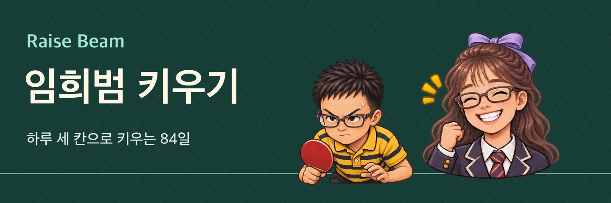
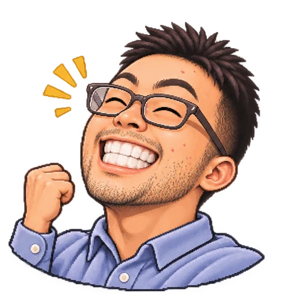

[](https://hooni9807.github.io/raise-beam/)

# 임희범 키우기

첫날 희범이에게는 6만 원과 세 칸의 일정이 있습니다. 농장 알바로 레슨비를 벌고, 탁구장에서 레슨을 받거나 첫 리그전에 나가 보세요. 공부와 봉사를 꾸준히 한 희범이에게는 또 다른 진로가 열립니다. 84일째 마지막 일정을 마치면 그동안의 선택이 25가지 엔딩 중 하나로 이어집니다.

**[게임 시작하기](https://hooni9807.github.io/raise-beam/)**　·　[하루 일정](#하루-일정)　·　[탁구장 활동](#탁구장-활동)　·　[엔딩 도감](#엔딩-도감)

## 첫날부터 어른이 될 때까지

게임을 열거나 새로고침하면 1996년 희범이의 탄생, 하루 일정 세 칸, 미래를 부탁하는 골목 인사로 이어지는 세 장면의 프롤로그가 재생됩니다. 마지막 장면에서 **게임 시작**을 눌러 캐릭터를 고릅니다. 첫 장면부터 **건너뛰기**로 바로 진행할 수 있고, 저장 기록이 있으면 마지막 버튼이 **이어하기**로 바뀌고 저장된 날부터 계속합니다. 캐릭터 선택에 따라 성장 모습, 상황별 표정, 엔딩 그림이 달라집니다. 진행 기록은 플레이한 브라우저에 자동으로 저장됩니다.

| | 애기범 | 꼬마범 | 사춘기범 | 어른범 |
| --- | --- | --- | --- | --- |
| 육성 기간 | 1–21일 | 22–42일 | 43–63일 | 64–84일 |
| 나이 | 1–6세 | 7–12세 | 13–18세 | 19–24세 |
| 능력치 상한 | 30 | 55 | 80 | 100 |

새 희범이는 **1레벨**로 시작합니다. 시작 시점보다 능력치 합계가 40 높아질 때마다 레벨이 하나 올라갑니다.

<details>
<summary>프롤로그 제작 노트</summary>

《프린세스 메이커 2 리제네레이션》의 공식 소개와 오프닝 트레일러 설명에서, 육성을 시작하기 전에 아이와 보낼 시간을 먼저 상상하게 하는 구성을 참고했습니다. 희범이의 세 장면은 이 게임의 소품에서 출발했습니다. 두 번째 장면의 안경은 희범이의 것이고, 공책의 빈칸 세 개는 플레이어가 채울 하루 일정입니다. 산부인과와 방, 골목은 프롤로그용으로 새로 그렸습니다. [공식 게임 소개](https://store.steampowered.com/app/2311530/) · [Bliss Brain 공식 애니메이션 트레일러](https://www.youtube.com/watch?v=zquMpCjbYuo)

</details>

### 희범이의 연습장

처음 홈에 들어오면 연습용 공책이 열립니다. 공부·운동·쉬기 중 하나를 골라 일정 한 칸을 채우고, 희범이의 컨디션과 지갑이 어떻게 달라지는지 확인하세요. **하루 마치기 연습**을 누르면 다음 날의 빈 세 칸이 열립니다. 연습을 끝내면 실제 게임은 들어오기 전의 날짜와 상태에서 이어집니다.

**건너뛰기**로 언제든 닫을 수 있습니다. 한 번 마치거나 건너뛴 브라우저에서는 **설정 → 게임 방법 다시 보기**로 다시 열 수 있습니다.

<details>
<summary>튜토리얼 설계 참고 자료</summary>

첫날 반복할 행동을 짧은 단계로 나누고, 결과를 확인한 뒤 다음 행동을 직접 선택하도록 구성했습니다. [Apple의 게임 온보딩 가이드](https://developer.apple.com/app-store/onboarding-for-games/) · [Xbox의 대화형 튜토리얼 지침](https://learn.microsoft.com/en-us/gaming/accessibility/xbox-accessibility-guidelines/109) · [Game Maker’s Toolkit 영상의 튜토리얼 나누기 장](https://www.youtube.com/watch?v=-GV814cWiAw&t=83s)

</details>

## 하루 일정

일반 행동은 한 번에 한 칸을 씁니다. **오늘의 도전**에 나갈 날에는 두 칸을 남겨 두세요. 예를 들어 첫 칸에 밥을 먹이면 컨디션을 15 회복하고 남은 두 칸으로 대회에 참가할 수 있습니다.

| 행동 | 기르는 능력 | 컨디션 | 비용·수입 |
| --- | --- | --- | --- |
| 밥 먹이기 | 체력 | +15 | 8,000원 지출 |
| 탁구장 가기 | 레슨 · 회원 지도 · 리그전 중 선택 | 활동별 소모 | 아래 탁구장 활동 참고 |
| 공부 | 지능 | -10 | 10,000원 지출 |
| 운동 | 체력 | -10 | 무료 |
| 고시 준비 | 용기 | -10 | 무료 |
| 농장 알바가기 | 끈기 · 체력 | -15 | 알바비 수입 |
| 봉사 | 인성 | -6 | 무료 |
| 공작 교실 | 손재주 · 지능 | -8 | 10,000원 지출 |
| 쉬기 | 휴식 | +25 | 무료 |

컨디션이 70 이상이면 훈련 효율이 1.2배, 30 미만이면 0.5배입니다. 컨디션이 10 이하일 때는 밥이나 휴식으로 회복해야 소모 행동을 다시 선택할 수 있습니다. 농장 알바비는 끈기가 높을수록, 성장 단계가 올라갈수록 늘어납니다.

<details>
<summary>오늘의 도전 8종과 승리 보상</summary>

하루에 한 번, 컨디션이 20을 넘어야 참가할 수 있습니다. 성공하면 상장 한 장을 받고 해당 능력이 3 오릅니다. 아래는 애기범 때의 상금이며, 다음 성장 단계마다 기본 상금의 한 배씩 늘어납니다. 탁구 대회는 패배해도 해당 경기 승리 포인트의 10%를 받습니다.

| 도전 | 판정 능력 | 기본 상금 |
| --- | --- | --- |
| 동네 탁구 대회 | 탁구 | 30,000원 |
| 국제 오픈 탁구 투어 | 탁구 | 25,000원 |
| 과학 경시대회 | 지능 | 40,000원 |
| 로봇 경진대회 | 손재주 | 40,000원 |
| 소방 안전 골든벨 | 용기 | 30,000원 |
| 꼬마 마라톤 | 체력 | 30,000원 |
| 한우 품평회 | 끈기 | 50,000원 |
| 모범 어린이 표창 | 인성 | 30,000원 |

</details>

<p align="center">
  
  
  
  
</p>

남녀 희범이의 네 성장 단계마다 상황 표정 12종이 있습니다. 첫 식사에는 입을 크게 벌리고, 첫 휴식에는 고개를 기울여 졸아요. 선생님께 칭찬받으면 한쪽 눈을 찡긋하며 브이를 하고, 솔깃한 투자 권유에는 입술을 삐죽 내밉니다. 같은 활동을 반복하거나 대회를 치르면 횟수와 결과에 따라 다른 반응도 볼 수 있습니다. 컨디션이 낮으면 하품하고, 엔딩 화면과 도감에서는 그림을 눌러 다른 표정을 볼 수 있습니다.

## 탁구장 활동

**탁구장 가기**를 누를 때마다 그날의 활동을 고릅니다. 한 활동에 일정 한 칸을 쓰며, 창을 닫고 돌아가면 일정을 쓰지 않습니다. 다음 방문에는 다른 활동을 선택할 수 있습니다.

| 활동 | 경험과 보상 | 컨디션 |
| --- | --- | --- |
| 레슨 받기 | 2만 원을 내고 탁구와 체력을 기릅니다. | −12 |
| 다른 사람 가르치기 | 회원을 지도해 인성과 탁구를 기르고 지도비 1만 원을 받습니다. | −8 |
| 리그전 출전 | 탁구와 체력을 기릅니다. 탁구 실력이 높을수록 승률이 오르고, 승패에 따라 랭킹 포인트를 얻습니다. | −16 |

리그전은 일정이 남아 있으면 다시 출전할 수 있습니다. 하루 한 번인 **오늘의 도전**에는 별도로 두 칸이 필요합니다.

## 기록과 갤러리

하루를 마치면 **기록**에 그날의 행동과 획득 포인트가 남습니다. **갤러리**에서는 첫 탁구 대회 승리로 얻은 탁구 유니폼이나 상장 10장으로 얻은 금메달을 입혀 볼 수 있습니다. 새로 키우기를 시작해도 이미 발견한 엔딩은 같은 브라우저의 도감에서 다시 볼 수 있습니다.

## 엔딩 도감

<details>
<summary>25가지 결말과 달성 조건 보기 · 스포일러</summary>

84일째 하루를 마치면 다음 순서로 결말을 정합니다.

1. 인성이 15 이하면 **연락 끊긴 아들 또는 딸**입니다. 그다음으로 컨디션 15 이하에서 마친 날이 누적 8회 이상이면 **번아웃**입니다.
2. 탁구장 기록으로 **관장**, **코치**, **선수** 순서로 자격을 확인합니다. 관장은 레슨·지도·리그전을 각각 8회 이상 경험하고 보유금이 30만 원 이상이어야 합니다. 코치는 지도가 12회 이상이며 지도 횟수가 레슨과 리그전 각각의 횟수 이상이어야 합니다.
3. 선수는 레슨 6회 이상, 리그전 8회 이상, 탁구 55 이상이면 **실업팀 탁구선수**가 됩니다. 선수 조건을 달성하면 홈에서 **국가대표 도전**을 눌러 지원할 국가를 고를 수 있습니다. 리그전 15회, 탁구 80, 국가별 선발 포인트까지 채우면 세계선수권 결승에서 **우승** 또는 **준우승**에 도전합니다. 포인트 기준은 스웨덴 8만, 대한민국·일본·독일 10만, 중국 15만입니다.
4. 이어서 아래 직업의 조건을 확인합니다. 여러 직업이 가능하면 능력치 분포가 가장 잘 맞는 직업을 선택합니다.
5. 위 조건에 해당하지 않고 탁구장을 6회 이상 이용했으면 **탁구장 청소부**가 됩니다. 그 외에는 보유금 15,000원 미만이면 **노숙자**, 능력치 합계 250 미만이면 **방구석 백수**, 나머지는 **회사원**입니다.

| 직업 | 최소 능력치 | 추가 조건 |
| --- | --- | --- |
| 헬스 트레이너 | 체력 85 · 인성 40 | — |
| 소방관 | 용기 70 · 체력 65 · 인성 50 | — |
| 경찰관 | 용기 65 · 인성 60 · 지능 50 | — |
| 우주비행사 | 지능 75 · 용기 75 · 체력 70 | — |
| 의사 | 지능 85 · 인성 60 · 끈기 60 | — |
| 간호사 | 인성 70 · 체력 60 · 지능 55 | — |
| 생명과학자 | 지능 85 · 끈기 70 | — |
| 교수 | 지능 75 · 인성 65 | — |
| 초등학교 선생님 | 인성 75 · 지능 55 | — |
| 전기기사 | 손재주 70 · 지능 55 · 용기 40 | 공작 교실 15회 |
| 한식 셰프 | 손재주 65 · 체력 55 · 끈기 55 | — |
| 크리에이터 | 용기 60 · 손재주 55 | 상장 5장 |
| 인기 BJ | 용기 65 · 체력 50 | 쉬기 15회 |
| 한우농장 사장님 | 끈기 70 · 체력 55 | 400,000원 |

</details>

## 로컬 실행

저장소 루트에서 아래 명령을 실행한 뒤 [로컬 게임](http://localhost:8000)을 엽니다.

```sh
python3 -m http.server 8000
```

`node test.mjs`로 게임 규칙과 엔딩 도달 테스트를 실행합니다. 육성 규칙은 [logic.js](logic.js), 화면과 저장 처리는 [app.js](app.js), 캐릭터 그림은 [img](img/)에 있습니다.

<details>
<summary>여자 희범 캐릭터의 그림 참고 자료</summary>

세 사진의 헤어스타일, 눈매, 웃는 인상을 참고해 게임 속 희범이를 각 나이와 상황에 맞는 픽셀 일러스트로 새로 그렸습니다.

| 사진 | 제작자 | 사진 라이선스 |
| --- | --- | --- |
| [카리나, 2025년 1월 공연](https://commons.wikimedia.org/wiki/File:KARINA_-_AESPA_-_2025.01.28.jpg) | David Lee | [CC BY 2.0](https://creativecommons.org/licenses/by/2.0/) |
| [장원영, 2023년 MMA](https://commons.wikimedia.org/wiki/File:2023_MMA_IVE_Wonyoung_1.jpg) | TenAsia | [CC BY 3.0](https://creativecommons.org/licenses/by/3.0/) |
| [송하영, 2019년 공개 녹화](https://commons.wikimedia.org/wiki/File:190611_송하영.jpg) | NINE STARS | [CC BY 3.0](https://creativecommons.org/licenses/by/3.0/) |

</details>

## 스물두 살에 도착한 편지

22세부터 홈에서 편지를 열 수 있습니다. 희범이는 라디오 작가 소라, 목수 지호, 철도 승무원 율 중 한 사람과 결혼하거나 혼자 살기로 답장할 수 있습니다. 답장은 한 번 보내면 저장됩니다. 미뤄 둔 편지는 마지막 날 엔딩을 보기 전에 다시 열립니다.

직업은 그동안 한 활동으로 결정되고, 엔딩 뒤에 이어지는 생활은 답장에 따라 갈립니다. 힘든 결말에는 같은 선택에도 다른 장면이 이어집니다. 발견한 직업과 후일담의 조합은 갤러리에서 다시 읽을 수 있습니다.

결혼을 선택 가능한 인생의 갈림길로 다루는 방식은 [Hasbro의 인생게임 안내](https://instructions.hasbro.com/en-us/instruction/the-game-of-life-family-board-game)와 [결혼을 다룬 인생게임 2 플레이 영상](https://www.youtube.com/watch?v=7JqvLCe4i5E)을 참고했습니다.
